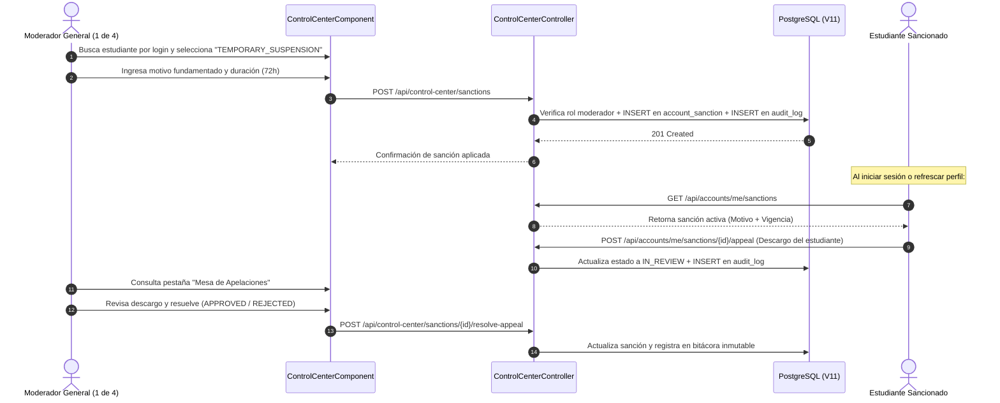

# Modelo de Moderación Centralizada y SteamBeta Control Center

**Versión:** 2.0.0  
**Estado:** *Implementado & Diseñado* (Esquema V11, endpoints REST y componente JavaFX completados)  
**Fecha:** Noviembre 2026  
**Ámbito:** Seguridad Institucional, Moderación Disciplinaria y Gobernanza de Campus  

---

## 1. Principios de la Moderación Universitaria

En una comunidad académica digital, la moderación debe equilibrar la libre expresión e intercambio de ideas con el respeto, la integridad académica y la sana convivencia estudiantil.

Para evitar la fragmentación, los abusos de autoridad y la arbitrariedad:
1. **Tope Institucional Estricto:** La gobernanza disciplinaria transversal recae exclusivamente en un cuerpo colegiado de **exactamente cuatro (4) Moderadores Generales** autorizados en todo el campus.
2. **Jerarquía Clara:** Los moderadores de comunidades locales gestionan publicaciones de su grupo específico. Los Moderadores Generales tienen jurisdicción institucional completa (suspensión temporal, advertencias formales y mediación institucional).
3. **Trazabilidad Inmutable:** Toda acción sancionatoria genera una entrada no modificable en la bitácora de auditoría global (`replica.global_moderation_audit_log`), registrando el moderador actuante, estudiante afectado, motivo tipificado, duración y marca temporal.
4. **Garantía del Debido Proceso y Derecho de Apelación:** Ningún estudiante puede ser sancionado sin justificación expresa, y la plataforma le otorga la posibilidad de interponer un recurso de apelación directamente desde su perfil personal.

---

## 2. Los 4 Moderadores Generales Institucionales

### 2.1 Restricción a Nivel de Base de Datos
El límite de cuatro moderadores generales no es una simple convención de software; está protegido por una función PL/pgSQL transaccional con bloqueo de tabla en PostgreSQL:

```sql
-- Definición en V11__global_moderation_and_campus_features.sql
CREATE OR REPLACE FUNCTION replica.assign_global_moderator(p_account_id BIGINT, p_granted_by BIGINT)
RETURNS VOID AS $$
DECLARE
    v_count INT;
BEGIN
    PERFORM replica.require_global_moderator(p_granted_by);
    
    -- Bloqueo consultivo de conteo
    SELECT COUNT(*) INTO v_count FROM public.account WHERE global_role IN ('GLOBAL_MODERATOR', 'ADMIN');
    IF v_count >= 4 THEN
        RAISE EXCEPTION 'LÍMITE ALCANZADO: El campus permite un máximo estricto de 4 Moderadores Generales simultáneos.';
    END IF;
    
    UPDATE public.account SET global_role = 'GLOBAL_MODERATOR' WHERE id = p_account_id;
    -- Registro en bitácora inmutable...
END;
$$ LANGUAGE plpgsql SECURITY DEFINER;
```

### 2.2 Procedimiento de Aprovisionamiento Administrativo
Cuando se instala el sistema por primera vez o se efectúa un relevo institucional de moderadores, el Administrador de Base de Datos (DBA) o el equipo de TI ejecuta el script de aprovisionamiento:

* **Script SQL Transaccional:** `backend/scripts/provision-global-moderators.sql`
* **Script Automatizado PowerShell:** `backend/scripts/provision-global-moderators.ps1`

El script valida que los logins indicados existan previamente, no superen el número de cuatro, actualiza el campo `global_role = 'GLOBAL_MODERATOR'` y deja constancia formal en la bitácora de eventos del sistema.

---

## 3. Catálogo de Medidas Disciplinarias Graduadas

El sistema define cinco niveles de intervención según la gravedad de la falta cometida (plagio, acoso, spam reiterado, suplantación o divulgación no autorizada de evaluaciones):

| Tipo de Sanción (`sanction_type`) | Alcance y Efectos en la Plataforma | Duración Típica | Capacidad de Apelación |
| :--- | :--- | :--- | :--- |
| **`WARNING`** (Aviso Preventivo) | Notificación privada en el perfil del alumno. No restringe funciones pero queda registrada en su historial. | Permanente en historial | No requerida |
| **`FORMAL_WARNING`** (Advertencia Formal) | Notificación destacada con requerimiento de lectura obligatoria al iniciar sesión. | Historial académico | Sí (revisión de hechos) |
| **`TEMPORARY_SUSPENSION`** (Suspensión Temporal) | El alumno no puede publicar, comentar ni enviar mensajes en ninguna comunidad durante el período fijado. Mantiene acceso de solo lectura a sus tareas personales. | 24 horas a 168 horas (1 semana) | Sí, inmediata |
| **`EXTENDED_SUSPENSION`** (Suspensión Mayor) | Bloqueo total de interacción comunitaria y cartelera. Su ficha de equipos de estudio queda oculta. | 15 a 90 días naturales | Sí, sujeta a revisión colegiada |
| **`ACCOUNT_DEACTIVATED`** (Desactivación de Cuenta) | Cierre de acceso a la plataforma. Reservada para faltas muy graves tipificadas en el reglamento universitario. | Indefinida / Definitiva | Vía comité de ética institucional |

---

## 4. El SteamBeta Control Center (Interfaz Privada)

Los cuatro moderadores generales disponen de una pestaña privilegiada en el menú lateral de la aplicación de escritorio (`ControlCenterComponent.java`).

### 4.1 Pestaña 1: Búsqueda y Gestión Disciplinaria de Alumnos
- **Buscador Dinámico:** Permite localizar cualquier estudiante por su login institucional, nombre completo o correo.
- **Ficha del Estudiante:** Muestra sanciones históricas, reportes acumulados y estado de cuenta (`ACTIVA`, `SUSPENDIDA`, `INACTIVA`).
- **Formulario de Imposición:**
  - Selector de Tipo de Sanción.
  - Duración en horas (calcula automáticamente el fin de vigencia).
  - Campo de Justificación Obligatoria (mínimo 15 caracteres; no permite imposición en blanco).

### 4.2 Pestaña 2: Bitácora de Auditoría en Tiempo Real
- Visualización tabular de la tabla inmutable `replica.global_moderation_audit_log`.
- Columnas: *ID, Fecha/Hora UTC, Moderador, Cuenta Afectada, Acción (`SANCTION_APPLIED`, `SANCTION_APPEALED`, `SANCTION_RESOLVED`), Motivo y Metadatos*.
- Exportación o consulta con filtros de fecha para presentación de informes ante comités universitarios.

### 4.3 Pestaña 3: Mesa de Apelaciones
- Recepción de los recursos ingresados por los estudiantes sancionados.
- El moderador puede revisar los descargos del estudiante, deliberar y registrar la resolución:
  - `APPROVED` (Apelación aceptada: levanta inmediatamente la suspensión y limpia el registro activo).
  - `REJECTED` (Apelación desestimada: ratifica la sanción con fundamento escrito).

---

## 5. Resumen de Flujo de Sanción y Apelación


